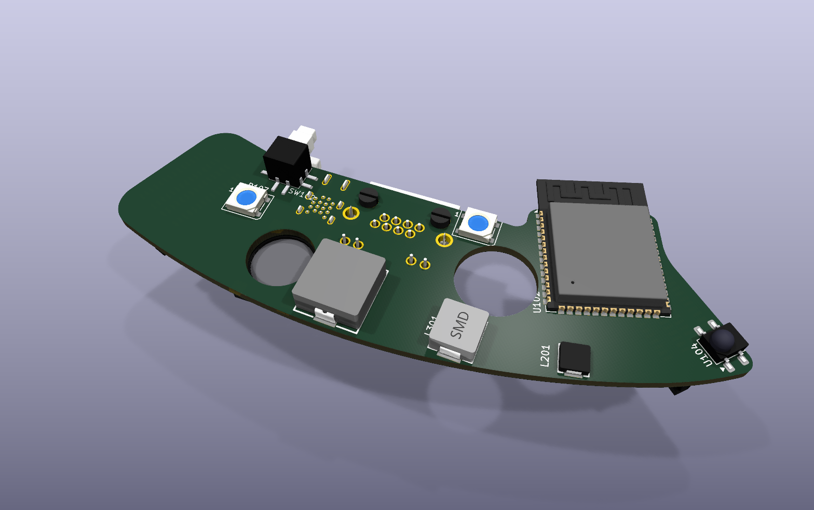
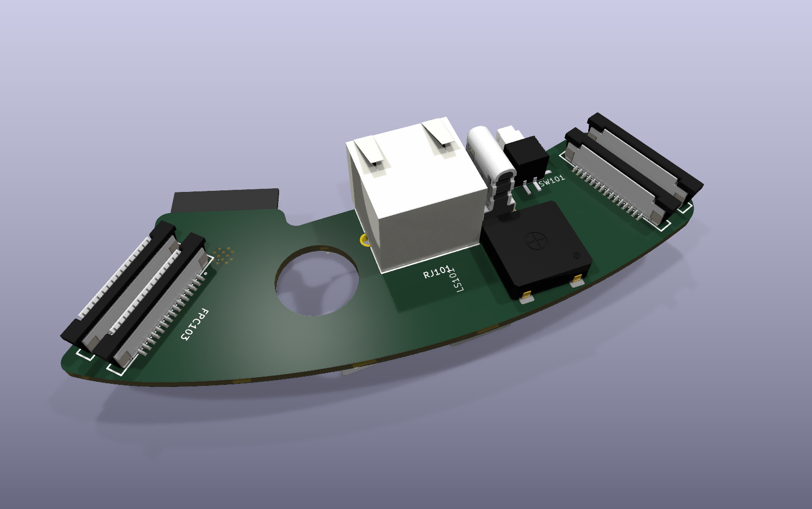

\# Sthymuli-motherboard
This repo contains the PCB for the Sthymuli motherboard. Sthymuli is an educative robot aimed at children whith the aim of promoting collaborative learning.

The motherboard is designed arround a doughnut shape with addons that plug in the center. the shape was chosen to encourage equal access to up to four children at a time interracting with the device.

## 3D view

| Top | Bottom |
|---|---|
|  |  |

## Exports

Regenerated automatically by the [export workflow](.github/workflows/export.yml) on every push to `main` that changes the design:

* [Schematic (PDF)](exports/Sthymuli-motherboard_schematic.pdf)
* [Layout (PDF, one page per layer)](exports/Sthymuli-motherboard_layout.pdf)
* [3D model (STEP)](exports/Sthymuli-motherboard.step), with only the parts placed on the board
* [3D render, top](exports/Sthymuli-motherboard_3d_top.png) / [bottom](exports/Sthymuli-motherboard_3d_bottom.png)

To run the same export locally: `scripts/export.sh` (see the comment at the top of the script for the Flatpak KiCad variant).

# Feature
The device contains the following sensors 

===

* # USB-C connector
* # Batterie + BMS
* # ESP32 + STM32
* # Speaker
* # Microphone
* # capacitive buttons (distributed arround the doughnut as discussed last time)
* # IR remote receive
* # 4 IR proximity Sensor
* # Motor Driver (so they can just connect the two wire of the motor and dont need to add a Hbridge on the dauther board
* # RGB LED (there I need to count how many and decide with you what we keep and what we breakout for the daugther board

\# Daugther boards

the following will be available for the daugther board :

* IMU
* color sensor
* 2 DC motor channel
* LEDs
* IR proximity sensor / analog pin that can be used for sensing
